<h1 align="center">Luis Rodríguez</h1>

  Desarrollador full-stack y de videojuegos en Buenos Aires, Argentina. 
  Construyo aplicaciones web con React y Firebase, y juegos 2D en Java. 
  Actualmente me estoy formando en Sistemas IT y ciberseguridad.

  
  
  

---

## Tecnologías

  
  
  
  
  
  
  
  
  
  
  
  
  
  
  
  
  
  
  
  
  
  
  
  
  
  
  
  
  

---

## Proyectos

### [loDePepe](https://github.com/l-sudo-l/loDePepe)
Tienda online de comida venezolana. Catálogo con filtrado por categoría, detalle de producto, carrito con estado global mediante Context API y checkout que genera órdenes de compra en Firestore.
`React` `Vite` `React Router` `Firebase`

### [Multiverse Dominion](https://github.com/TomasRaiter/Multiverse_Dominion)
Juego de lucha 2D con modo historia de 8 niveles, modo PvP, bot con distintos niveles de dificultad y cinemáticas. Proyecto en equipo: me encargué de la corrección de errores en la lógica principal, el escalado de pantalla y la documentación.
`Java` `Swing`

### [StarPong](https://github.com/l-sudo-l/StarPong)
Versión del Pong clásico ambientada en Star Wars, con menú principal, sonido y ciclo de juego en un hilo propio.
`Java` `POO` `Threads`

### [CV](https://github.com/l-sudo-l/CV)
Currículum web responsive, preparado para imprimir en formato A4.
`HTML` `CSS` `JavaScript`

### [Fitmind AI](https://github.com/l-sudo-l/Fitmind-AI)
Sitio web multipágina para una plataforma de entrenamiento cognitivo: inicio, servicios, planes y contacto.
`HTML` `CSS` `JavaScript`

---

## Estadísticas

  
  

 

<picture>
  <source media="(prefers-color-scheme: dark)" srcset="https://raw.githubusercontent.com/l-sudo-l/l-sudo-l/pacman-output/pacman-contribution-graph-dark.svg">
  <source media="(prefers-color-scheme: light)" srcset="https://raw.githubusercontent.com/l-sudo-l/l-sudo-l/pacman-output/pacman-contribution-graph.svg">
  
</picture>

---

## Actualmente

- Estudiando ciberseguridad: redes, Linux y seguridad en aplicaciones web.
- Buscando mi primera experiencia profesional como desarrollador.
